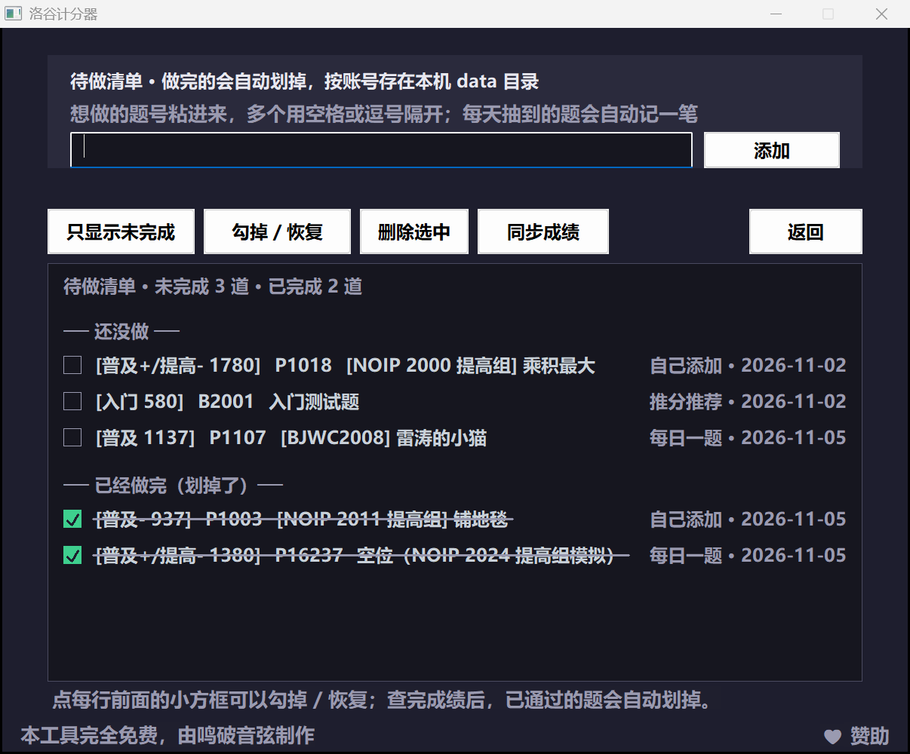
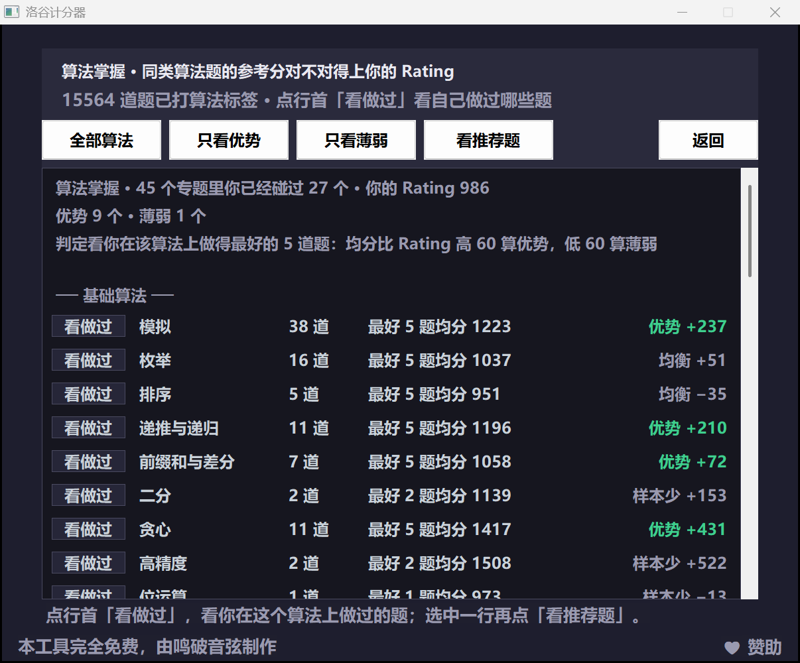
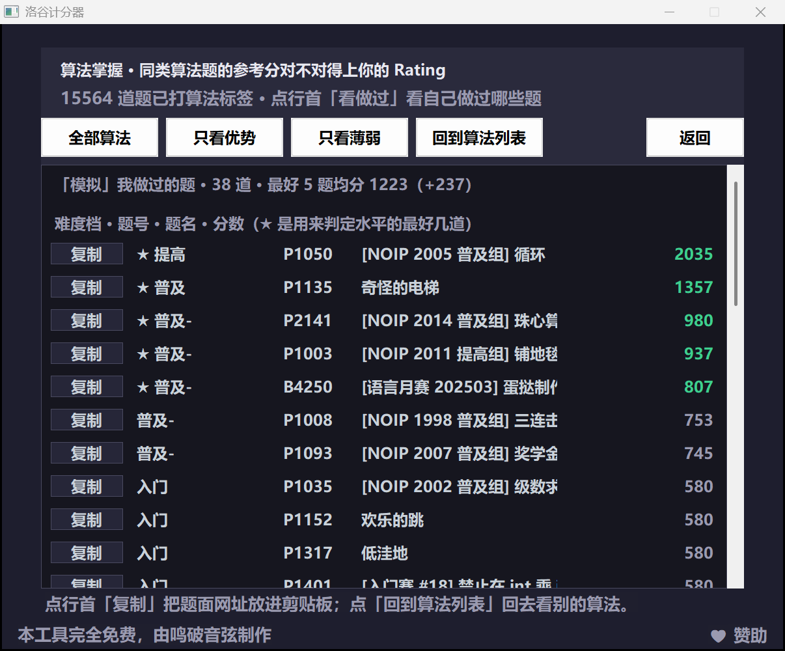
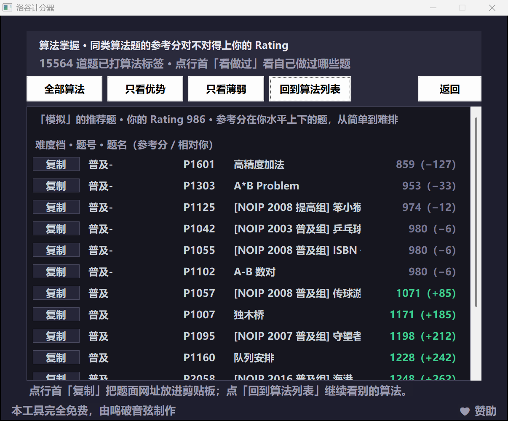

# 洛谷计分器 · Luogu Scorer

> **本工具完全免费，由鸣破音弦制作。** 谢绝任何形式的付费转售；若你是花钱买到的，说明你被骗了。

一个 Windows 桌面小工具：登录（或用公开模式查询）洛谷账号，把「已通过」的题目按难度算成 **B50 Rating**，并能按难度分组浏览、挑题、每日一题、记待做清单、看算法掌握度。

纯 Win32 + C++，单文件源码，静态链接，**不需要 .NET / Python / 运行库**，双击即用。所有数据都存在程序旁边的 `data\` 目录里。


## 功能

- **三种登录方式**
  - `password`：洛谷账号 + 密码（自动取登录页的 `__csrf`）
  - `cookie`：从浏览器 F12 里复制 `_uid` / `_client_id` / `__csrf`
  - `public`：只填用户名或 UID，不登录也能查公开的通过记录
- **Rating 计分**：取最好的 50 题总分 ÷ 50（题不满 50 也除以 50，避免小题量占便宜）
- **题目列表**：按难度分组 / 按分数 / 按题号三种视图，双击题号用浏览器打开
- **每日一题**：按当前 Rating 挑一道略高于水平的题，可一键复制/打开
- **推分推荐**：从「比现在水平高一截」的题里挑一道，用来推分
- **待做清单**：每日一题 / 推分推荐抽到的题自动记一笔，也能自己粘题号批量导入；做完的题**自动划掉但还看得见**，未完成与已完成分组显示
- **算法掌握**：把已通过的题按算法专题归类，用「你在该算法上做得最好的 5 道题」的均分和你的 Rating 比，标出优势 / 薄弱，并能从数据文件里推荐该专题的题
- **个人账号**：本地账号 + 绑定洛谷 UID，成绩、待做清单自动归档到 `data\accounts\<账号>\`
- **高分屏友好**：Per-Monitor V2 DPI 感知，界面按系统缩放比例放大，150% 下字不糊
- **♥ 赞助**：界面右下角有个小入口，点一下就把赞助页链接复制到剪贴板（不会自动开浏览器）






## 快速开始

1. 下载本仓库（`Code → Download ZIP`，或 `git clone`）。
2. 双击根目录的 `LuoguScorer.exe`（自己编译见 [BUILD.md](BUILD.md)）。
3. 点「开始」→ 选登录方式 → 登录并获取已通过题目。

> `LuoguScorer.exe` 要和 `data\` 目录放在同一层：程序只读写自己所在目录下的 `data\`。

`data\difficulty_scores.json` 是随仓库提供的题目分数表，删掉会退回「按难度基准分」的粗略算法；`data\algorithm_index.jsonl` 是题目到算法专题的索引（15564 道 P/B 题），删掉「算法掌握」会提示缺文件；`data\accounts.json` 只在「个人账号」里注册后才会生成。

## 计分规则

```
Rating = （已通过题目里分数最高的 50 道之和） ÷ 50
```

单题分数由洛谷难度标签和通过率共同决定：

| 难度（洛谷）        | 基准分  | 分数范围                                   |
| ------------- | ---- | -------------------------------------- |
| 未评定           | 800  | 620 ~ 980                              |
| 入门            | 400  | 220 ~ 580                              |
| 普及-           | 800  | 620 ~ 980                              |
| 普及            | 1200 | 1000 ~ 1380                            |
| 普及+/提高-       | 1600 | 1420 ~ 1780                            |
| 提高            | 2000 | 1820 ~ 2180                            |
| 提高+/省选-       | 2400 | 2220 ~ 2580                            |
| 省选/NOI-       | 2800 | 2620 ~ 3199（通过率最低的 25% 抬到 3200 ~ 4000） |
| NOI/NOI+/CTSC | 3200 | 3200 ~ 4000                            |

同一档里按通过率的 logit 做 z 分数，`分数 = 基准 + 180 × (−z)`，同档最多拉开 360 分；提交量很小的题会按 `√提交量 / 40` 的置信度向基准收缩。完整的推导、审核数据和异常清单见 [docs/评分算法与分数表说明.md](docs/评分算法与分数表说明.md)。

个别题可以手工覆盖分数：`data\problem_rating.json` 里写 `{"P1012": 900}` 即可（优先级高于自动分数）。

## 待做清单

「待做清单」在启动页第二行，按账号存在 `data\accounts\<账号>\todo.json`。


- **自动记一笔**：点「每日一题」或「推分推荐」抽到的题，会直接进清单，来源栏写「每日一题」/「推分推荐」。
- **自己导入**：把题号粘到输入框，多个用空格或逗号隔开（`P1001 P1002 B2001`、`P1001,P1002` 都行），点「添加」。
- **做完自动划掉**：每次「同步成绩」拿到新的通过记录后，清单里已经通过的题会被划掉，但**不从清单里删除**——字还在、颜色和字重都不变，只多一道横线。想恢复就再点一次它前面的方框。
- **分开看**：默认把「还没做」和「已经做完（划掉了）」分成两组；点「只显示未完成」可以把做完的藏起来。
- **手动改**：点每行前面的小方框就是勾掉 / 恢复；先点一行选中，再点「勾掉 / 恢复」「删除选中」也行；`↑` `↓` 换行、空格勾掉，滚轮滚列表。
- **题名会补全**：添加时题名还不知道的，等下次拉取通过记录时会把题名补上；一直没做过就显示「（题名未知）」。

## 算法掌握

「算法掌握」把已通过的题按算法专题归档，回答一个问题：**这个算法的题，我做出来的分数对不对得上我的 Rating？**


- **判定标准**：取你在该算法上**做得最好的 5 道题**（不足 5 道就全取）算均分，再和你的 Rating 比。均分高出 60 分算「优势」，低 60 分算「薄弱」，中间算「均衡」；在该算法上只做过不到 4 道题时标「样本少」，不参与结论。
  - 为什么取最好的几道而不是平均分：简单题会把平均分拖下去，看到的就不是「你的上限」而是「你做过多少水题」。
- **两类视图**：「全部算法」按基础 / 进阶 / 高级分组列 45 个专题；「只看优势」「只看薄弱」过滤。列依次是专题、做过几道、最好 K 题均分、相对你 Rating 的差（绿=优势，红=薄弱，灰=持平或样本少）。
- **行首「看做过」按钮 = 我做过哪些题**：每个专题那一行最左边有个小按钮，点它就列出你在这个算法上做过的每一道题（按分数从高到低排），前 5 道前面带 ★，正是上面那行「最好 5 题均分」用到的题。

  

- **看推荐题**：选中一个专题再点「看推荐题」，会从 `data\algorithm_index.jsonl` 里挑出该专题、参考分在你水平上下的题，按分数从简单到难排。
- **行首「复制」按钮 = 复制题面网址**：推荐题和我做过的题，每一行最左边也有一个「复制」小按钮，点它就把 `https://www.luogu.com.cn/problem/题号` 放进剪贴板。不直接拉浏览器，是因为低权限进程启动 Edge 经常静默失败，复制网址更可靠。

  
- **长题名不会看不全**：题名列放不下的名字不截断成「…」，而是像广告牌那样一路往左滚，滚到头再从右边接着出现，一直循环，不用悬停也不用点开。待做清单里的长题名也一样，那根删除线会跟着字一起走。
- **数据从哪来**：`data\algorithm_index.jsonl` 是 15564 道 P/B 题的「题号 → 算法专题」索引，用洛谷题目页的算法标签聚合而成。想更新就跑 `python tools\build_algo_index.py`（脚本注释里写了输入格式）。
- 这个功能只吃你**已经通过**的题，不评分、不上传、不联网算，全在本机内存里跑。

## 数据与隐私

- 所有内容都在本机 `data\` 目录，不联网上传任何东西。
- 本地账号密码只保存 `salt + SHA-256`，不存明文；洛谷密码 / Cookie **不落盘**，只在当次请求里用。
- 查询别人的账号时，成绩单独存到 `data\others\<uid>\`，不会混进你自己的档案。
- `data\` 里跟个人有关的文件已经在 `.gitignore` 里排除，提交仓库前不会带上你的成绩。

## 项目结构

```
.
├─ LuoguScorer.exe               编译好的程序（Windows x64，和 data\ 同级）
├─ src/luogu_scorer.cpp          全部源码（约 3700 行，单文件）
├─ luogu_scorer.rc               资源脚本：图标 + 版本信息 + manifest
├─ luogu_scorer.manifest         清单：asInvoker、Per-Monitor V2 DPI、Win10/11
├─ app.ico                       程序图标
├─ data/                         运行时数据
│  ├─ config.json                Rating 档位、topN 等配置
│  ├─ difficulty_scores.json     4.5 万道题的分数表
│  ├─ algorithm_index.jsonl      15564 道题的算法专题索引（算法掌握用）
│  └─ problems*.jsonl            生成分数表用的原始统计（提交量/通过量）
├─ tools/
│  ├─ gen_scores.py              重新生成分数表
│  ├─ verify_scores.py           校验分布与单调性
│  ├─ build_algo_index.py        重新生成算法专题索引
│  ├─ unblock.ps1                一键解除「网络下载」锁定（SmartScreen 弹窗）
│  └─ setup_mingw.sh             一键拉 MinGW-w64 工具链
├─ docs/
│  ├─ 制作过程与教程.md           vibe coding 复盘 + 完整使用教程
│  ├─ 作者寄语.md                 作者的话
│  ├─ 评分算法与分数表说明.md     分数表的审核报告
│  ├─ 代码签名指南.md             为什么被拦、怎么申请免费 OSS 签名
│  └─ images/                    截图
├─ .github/workflows/            CI：自动编译 + 签名流水线骨架
├─ BUILD.md                      编译说明
└─ LICENSE
```

## 被 Windows 拦住了？

从 GitHub 下载 ZIP 再解压，Windows 会给每个文件打一个「来自网络」的标记（Mark-of-the-Web）。双击一个**没有代码签名**的 exe，SmartScreen 就会弹「Windows 已保护你的电脑」。这不是程序坏了，是 Windows 不认识它。

三种解法，任选：

1. **右键 exe → 属性 → 常规**，最下面勾选「解除锁定」→ 确定，再双击。
2. **命令行一次清掉整个文件夹的标记**（推荐，解压后执行一次即可）：
   ```powershell
   # 在解压出来的目录里打开 PowerShell，把当前以及子目录里的文件都解锁
   Get-ChildItem -Recurse -File | Unblock-File
   ```
   仓库里也带了一个小脚本，效果一样：`powershell -ExecutionPolicy Bypass -File tools\unblock.ps1`。
3. 在 SmartScreen 弹窗里点「更多信息 → 仍要运行」。

如果拦你的是杀毒软件（不是 SmartScreen），那是启发式误报：静态链接的 MinGW 程序 + 单文件 GUI 的组合比较少见，容易被打分。可以把它加入信任目录，或者干脆按 [BUILD.md](BUILD.md) 自己编译一份——自己机器上编出来的不会带「网络下载」标记。

> 实测（2026-11）：给 exe 手动打上 Mark-of-the-Web 后跑 Windows Defender 扫描，**没有报毒**；Get-AuthenticodeSignature 显示 NotSigned。也就是说实际会拦你的只有 SmartScreen 的「未知发布者」，不是杀毒软件。

**能不能从代码层面彻底绕过去？** 不能。SmartScreen 看的是「签名 + 下载量积累的声誉」，跟程序内部写了什么无关；真要让弹窗消失，只有一条路是**代码签名**：

- 开源项目可以申请 [SignPath Foundation](https://signpath.org/) 的免费签名（面向 OSS，需要公开仓库和一次审核）；
- 也可以用 [Azure Trusted Signing](https://learn.microsoft.com/azure/trusted-signing/)（个人开发者需要 Entra ID P2 / Governance 订阅，不只是每月 $9.99）；
- 自己用 `signtool` 做的自签名证书不管用——SmartScreen 只认受信任的 CA 签发、且已经有一定下载量的证书。签名后也要等一段时间的下载量，弹窗才会慢慢消失。

完整的申请步骤、资格逐条对照、GitHub Actions 签名流水线骨架、以及「哪些做法其实没用」都写在 [docs/代码签名指南.md](docs/代码签名指南.md) 里。

本程序在代码层面能做的只是「尽量不像可疑文件」，这些已经做了：

- 嵌入图标、`VERSIONINFO`（文件说明 / 产品名 / 版本 / 版权，属性页里能看到「洛谷计分器 1.1.0.0」）；
- 嵌入 manifest：`asInvoker`（不要求管理员权限，不会触发 UAC）、Per-Monitor V2 DPI、声明支持 Win10/11、`longPathAware`；
- 链接时启用 `--nxcompat`、`--dynamicbase`、`--high-entropy-va`（ASLR / DEP），并 `strip` 掉符号；
- 保证二进制里只有**一份** manifest（MinGW 自带的那份要关掉，否则两份打架，见 BUILD.md）；
- 二进制里没有加壳、没有自解压、没有下载器行为。

## 常见问题

| 现象                      | 处理                                                                                            |
| ----------------------- | --------------------------------------------------------------------------------------------- |
| 首次运行被 SmartScreen / 杀软拦 | 程序没有代码签名。最快的办法：右键 exe → 属性 → 勾「解除锁定」→ 确定；或者点「更多信息 → 仍要运行」。详见 [被 Windows 拦住了？](#被-windows-拦住了) |
| 登录失败，提示人机验证             | 洛谷风控拦了密码登录，改用 `cookie` 或 `public` 模式                                                          |
| Rating 偏低 / 全是 0        | 确认 `data\difficulty_scores.json` 还在；没有分数表时只能按难度基准分估算                                          |
| 双击题号没反应                 | 系统没有默认浏览器关联，手动复制题号打开                                                                          |
| 算法掌握页空白 / 弹「缺 algorithm_index.jsonl」 | `data\algorithm_index.jsonl` 被删了，从仓库重新拷一份，或跑 `python tools\build_algo_index.py` 重生成 |
| 待做清单里做完的题没划掉           | 点「同步成绩」重新拉一次通过记录；清单只在你查成绩后才更新                                                          |

## 已知限制

- 只支持 Windows（Win32 API + WinINet）。
- 洛谷接口不是公开 API，字段或路径变化时可能失效；`password` 登录可能被人机验证拦截，此时改用 `cookie` 或 `public`。
- 分数表是基于「提交量 / 通过量」的统计估计，不等于官方难度评分。
- 算法标签是按洛谷题目页的算法标签聚合的，一道题可能同时属于多个专题；没有标签的老题不会出现在算法掌握里。
- 请勿高频请求，避免给对方服务器造成压力。

## 赞助作者

如果这个小工具帮你省了点时间，可以请作者喝杯咖啡：

<https://afdian.com/a/PoYinprogramme>

程序右下角那个「♥ 赞助」按钮就是干这个的——点它只会把上面的链接复制到剪贴板，不会自动打开浏览器，你自己粘贴到地址栏就行。

## 免责声明

本项目是非官方的个人学习作品，与洛谷（luogu.com.cn）官方无关；请只查询你本人或已获授权的账号，并遵守网站的服务条款。

### Code signing policy / 代码签名政策

本项目的 Windows 可执行文件通过 [SignPath Foundation](https://signpath.org/) 申请免费的 OSS 代码签名。

- **Committer**：[@Magicianqw](https://github.com/Magicianqw)
- **Reviewer**：[@Magicianqw](https://github.com/Magicianqw)
- **Approver**：[@Magicianqw](https://github.com/Magicianqw)

签名范围与承诺：

- 只为本仓库（LuoguRating）公开源码编译出的产物签名，不签名任何第三方代码或来源不明的二进制；
- 本程序不收集、不上传任何用户数据；账号、成绩与缓存全部保存在程序目录下的 `data\` 文件夹里；
- 本程序不修改系统配置、不写注册表、不安装服务、不常驻后台；解压即用，删掉文件夹即卸载；
- 主分支受保护，所有签名请求由上述 Approver 在 GitHub Actions 中人工确认后发起。

## License

[MIT](LICENSE)
