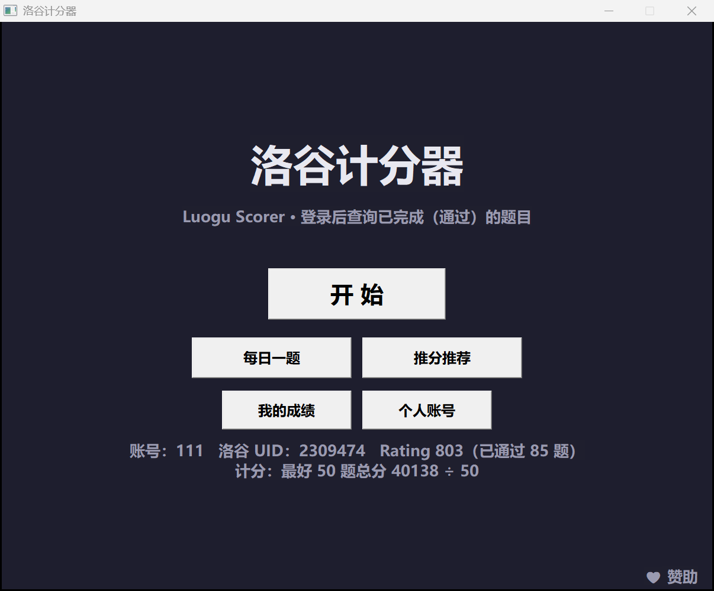
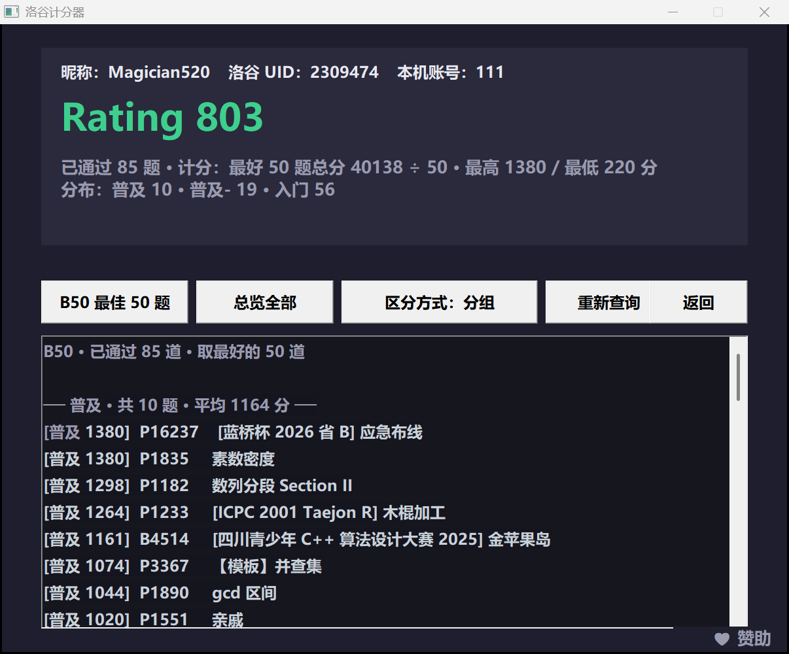
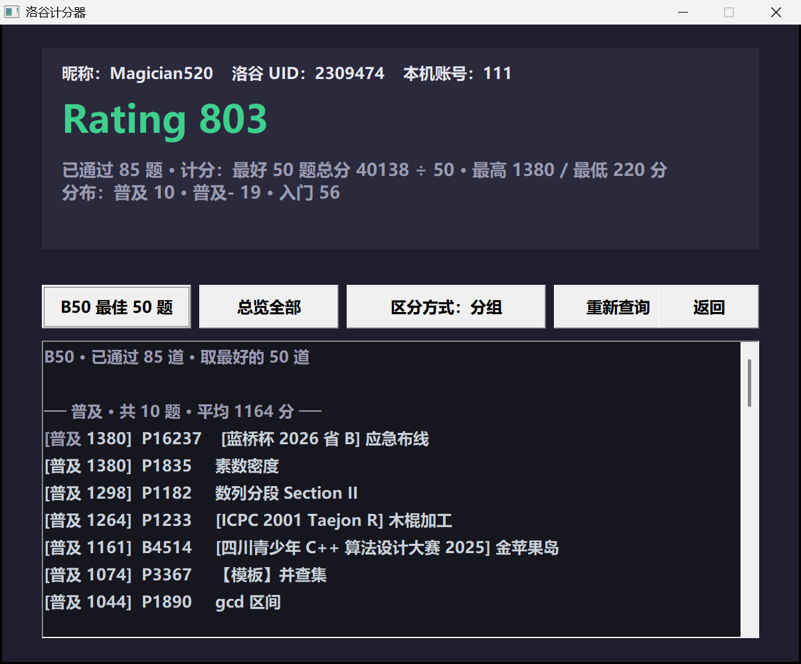

# 洛谷计分器 · Luogu Scorer

一个 Windows 桌面小工具：登录（或用公开模式查询）洛谷账号，把「已通过」的题目按难度算成 **B50 Rating**，并能按难度分组浏览、挑题、每日一题。

纯 Win32 + C++，单文件源码，静态链接，**不需要 .NET / Python / 运行库**，双击即用。所有数据都存在程序旁边的 `data\` 目录里。



## 功能

- **三种登录方式**
  - `password`：洛谷账号 + 密码（自动取登录页的 `__csrf`）
  - `cookie`：从浏览器 F12 里复制 `_uid` / `_client_id` / `__csrf`
  - `public`：只填用户名或 UID，不登录也能查公开的通过记录
- **Rating 计分**：取最好的 50 题总分 ÷ 50（题不满 50 也除以 50，避免小题量占便宜）
- **题目列表**：按难度分组 / 按分数 / 按题号三种视图，双击题号用浏览器打开
- **每日一题**：按当前 Rating 挑一道略高于水平的题，可一键复制/打开
- **推分推荐**：从「比现在水平高一截」的题里挑一道，用来推分
- **个人账号**：本地账号 + 绑定洛谷 UID，成绩自动归档到 `data\accounts\<账号>\`
- **高分屏友好**：Per-Monitor V2 DPI 感知，150% 缩放下字不糊
- **♥ 赞助**：界面右下角有个小入口，点一下就把赞助页链接复制到剪贴板（不会自动开浏览器）





## 快速开始

1. 下载本仓库（`Code → Download ZIP`，或 `git clone`）。
2. 双击根目录的 `LuoguScorer.exe`（自己编译见 [BUILD.md](BUILD.md)）。
3. 点「开始」→ 选登录方式 → 登录并获取已通过题目。

> `LuoguScorer.exe` 要和 `data\` 目录放在同一层：程序只读写自己所在目录下的 `data\`。

`data\difficulty_scores.json` 是随仓库提供的题目分数表，删掉会退回「按难度基准分」的粗略算法；`data\accounts.json` 只在「个人账号」里注册后才会生成。

## 计分规则

```
Rating = （已通过题目里分数最高的 50 道之和） ÷ 50
```

单题分数由洛谷难度标签和通过率共同决定：

| 难度（洛谷） | 基准分 | 分数范围 |
| --- | --- | --- |
| 未评定 | 800 | 620 ~ 980 |
| 入门 | 400 | 220 ~ 580 |
| 普及- | 800 | 620 ~ 980 |
| 普及 | 1200 | 1000 ~ 1380 |
| 普及+/提高- | 1600 | 1420 ~ 1780 |
| 提高 | 2000 | 1820 ~ 2180 |
| 提高+/省选- | 2400 | 2220 ~ 2580 |
| 省选/NOI- | 2800 | 2620 ~ 3199（通过率最低的 25% 抬到 3200 ~ 4000） |
| NOI/NOI+/CTSC | 3200 | 3200 ~ 4000 |

同一档里按通过率的 logit 做 z 分数，`分数 = 基准 + 180 × (−z)`，同档最多拉开 360 分；提交量很小的题会按 `√提交量 / 40` 的置信度向基准收缩。完整的推导、审核数据和异常清单见 [docs/评分算法与分数表说明.md](docs/评分算法与分数表说明.md)。

个别题可以手工覆盖分数：`data\problem_rating.json` 里写 `{"P1012": 900}` 即可（优先级高于自动分数）。

## 数据与隐私

- 所有内容都在本机 `data\` 目录，不联网上传任何东西。
- 本地账号密码只保存 `salt + SHA-256`，不存明文；洛谷密码 / Cookie **不落盘**，只在当次请求里用。
- 查询别人的账号时，成绩单独存到 `data\others\<uid>\`，不会混进你自己的档案。
- `data\` 里跟个人有关的文件已经在 `.gitignore` 里排除，提交仓库前不会带上你的成绩。

## 项目结构

```
.
├─ LuoguScorer.exe               编译好的程序（Windows x64，和 data\ 同级）
├─ src/luogu_scorer.cpp          全部源码（约 2700 行，单文件）
├─ luogu_scorer.rc               资源脚本：图标 + 版本信息 + manifest
├─ luogu_scorer.manifest         清单：asInvoker、Per-Monitor V2 DPI、Win10/11
├─ app.ico                       程序图标
├─ data/                         运行时数据
│  ├─ config.json                Rating 档位、topN 等配置
│  ├─ difficulty_scores.json     4.5 万道题的分数表
│  └─ problems*.jsonl            生成分数表用的原始统计（提交量/通过量）
├─ tools/
│  ├─ gen_scores.py              重新生成分数表
│  ├─ verify_scores.py           校验分布与单调性
│  ├─ unblock.ps1                一键解除「网络下载」锁定（SmartScreen 弹窗）
│  └─ setup_mingw.sh             一键拉 MinGW-w64 工具链
├─ docs/
│  ├─ 制作过程与教程.md           vibe coding 复盘 + 完整使用教程
│  ├─ 作者寄语.md                 作者的话（待填）
│  ├─ 评分算法与分数表说明.md     分数表的审核报告
│  └─ images/                    截图
├─ BUILD.md                      编译说明
└─ LICENSE
```

## 被 Windows 拦住了？

从 GitHub 下载 ZIP 再解压，Windows 会给每个文件打一个「来自网络」的标记（Mark-of-the-Web）。双击一个**没有代码签名**的 exe，SmartScreen 就会弹「Windows 已保护你的电脑」。这不是程序坏了，是 Windows 不认识它。

三种解法，任选：

1. **右键 exe → 属性 → 常规**，最下面勾选「解除锁定」→ 确定，再双击。
2. **命令行一次清掉整个文件夹的标记**（推荐，解压后执行一次即可）：

   ```powershell
   # 在解压出来的目录里打开 PowerShell，把当前以及子目录里的文件都解锁
   Get-ChildItem -Recurse -File | Unblock-File
   ```

   仓库里也带了一个小脚本，效果一样：`powershell -ExecutionPolicy Bypass -File tools\unblock.ps1`。
3. 在 SmartScreen 弹窗里点「更多信息 → 仍要运行」。

如果拦你的是杀毒软件（不是 SmartScreen），那是启发式误报：静态链接的 MinGW 程序 + 单文件 GUI 的组合比较少见，容易被打分。可以把它加入信任目录，或者干脆按 [BUILD.md](BUILD.md) 自己编译一份——自己机器上编出来的不会带「网络下载」标记。

**能不能从代码层面彻底绕过去？** 不能。SmartScreen 看的是「签名 + 下载量积累的声誉」，跟程序内部写了什么无关；真要让弹窗消失，只有一条路是**代码签名**：

- 开源项目可以申请 [SignPath Foundation](https://signpath.org/) 的免费签名（面向 OSS，需要公开仓库和一次审核）；
- 也可以用 [Azure Trusted Signing](https://learn.microsoft.com/azure/trusted-signing/)（个人开发者约 $9.99/月）；
- 自己用 `signtool` 做的自签名证书不管用——SmartScreen 只认受信任的 CA 签发、且已经有一定下载量的证书。签名后也要等一段时间的下载量，弹窗才会慢慢消失。

本程序在代码层面能做的只是「尽量不像可疑文件」，这些已经做了：

- 嵌入图标、`VERSIONINFO`（文件说明 / 产品名 / 版本 / 版权，属性页里能看到「洛谷计分器 1.0.0.0」）；
- 嵌入 manifest：`asInvoker`（不要求管理员权限，不会触发 UAC）、Per-Monitor V2 DPI、声明支持 Win10/11；
- 链接时启用 `--nxcompat`、`--dynamicbase`、`--high-entropy-va`（ASLR / DEP），并 `strip` 掉符号；
- 二进制里没有加壳、没有自解压、没有下载器行为。

## 常见问题

| 现象 | 处理 |
| --- | --- |
| 首次运行被 SmartScreen / 杀软拦 | 程序没有代码签名。最快的办法：右键 exe → 属性 → 勾「解除锁定」→ 确定；或者点「更多信息 → 仍要运行」。详见 [被 Windows 拦住了？](#被-windows-拦住了) |
| 登录失败，提示人机验证 | 洛谷风控拦了密码登录，改用 `cookie` 或 `public` 模式 |
| Rating 偏低 / 全是 0 | 确认 `data\difficulty_scores.json` 还在；没有分数表时只能按难度基准分估算 |
| 双击题号没反应 | 系统没有默认浏览器关联，手动复制题号打开 |

## 已知限制

- 只支持 Windows（Win32 API + WinINet）。
- 洛谷接口不是公开 API，字段或路径变化时可能失效；`password` 登录可能被人机验证拦截，此时改用 `cookie` 或 `public`。
- 分数表是基于「提交量 / 通过量」的统计估计，不等于官方难度评分。
- 请勿高频请求，避免给对方服务器造成压力。

## 赞助作者

如果这个小工具帮你省了点时间，可以请作者喝杯咖啡：

<https://afdian.com/a/PoYinprogramme>

程序右下角那个「♥ 赞助」按钮就是干这个的——点它只会把上面的链接复制到剪贴板，不会自动打开浏览器，你自己粘贴到地址栏就行。

## 免责声明

本项目是非官方的个人学习作品，与洛谷（luogu.com.cn）官方无关；请只查询你本人或已获授权的账号，并遵守网站的服务条款。

## License

[MIT](LICENSE)
